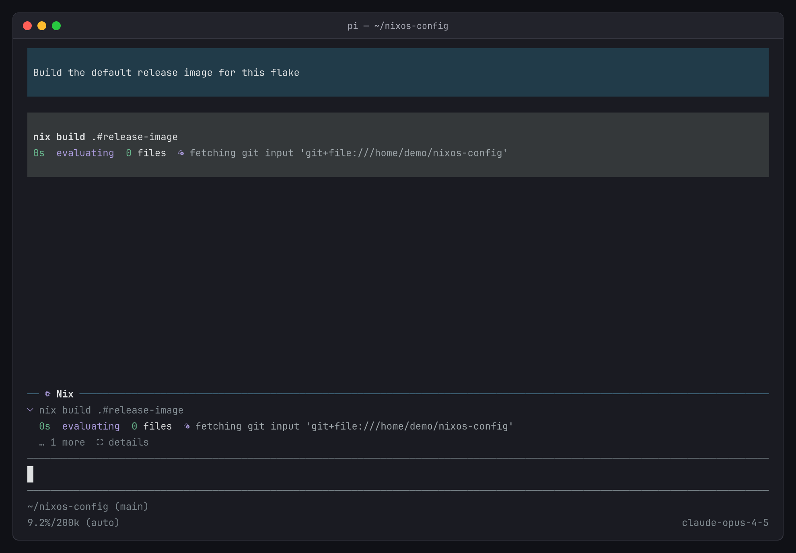
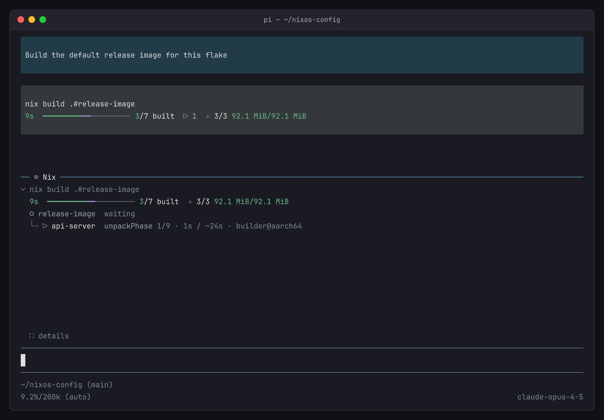
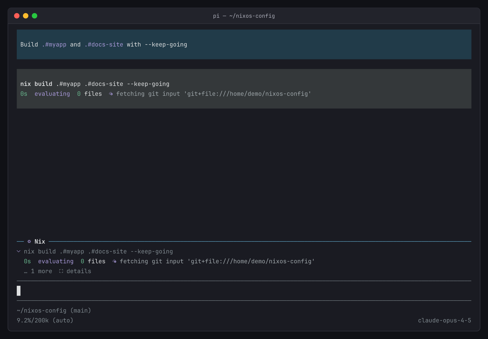

# pi-nix-build

English | [简体中文](docs/zh/README.md)

A [pi](https://github.com/earendil-works/pi) extension for Nix builds with live progress, failure diagnostics, and background job monitoring.

## Showcase

### Live Progress Widget

Displays evaluation progress, dependency tree, stdenv phases, remote builder hosts, duration estimates, active transfers, and `Ctrl+Shift+B` compact collapse above the editor.



### Fullscreen Detail View (`Ctrl+Shift+M`)

Inspects every derivation in the dependency forest alongside its build log, with auto-follow pause/resume (`↓ N newer lines`) and keyboard or mouse navigation.



### Failure Diagnostics & Hash Mismatch

Surfaces failed derivations, trailing log lines, dependency blocks (`⊘`), and fixed-output hash mismatches (`specified` vs `got`).



## Features

- **Live build progress**: Displays evaluation status, dependency trees, build phases, remote builders, and estimated build times above the editor.
- **Fullscreen detail view**: Inspects all derivations and their captured logs during or after a build.
- **Flake and non-flake support**: Supports both `nix build` (flake installables) and `nix-build` (files, expressions, and attribute paths).
- **Failure diagnostics**: Reports failed derivations, trailing log lines, fixed-output hash mismatches, and full log paths directly to pi.
- **Background builds and watches**: Runs long builds in the background with event notifications, and registers jobs in `/ps` when [`pi-processes`](https://github.com/aliou/pi-processes) is loaded.
- **Command redirection**: Intercepts `nix build` and `nix-build` invocations in shell and process tools, routing them through `nix_build`.

## Requirements

- [pi](https://github.com/earendil-works/pi)
- Node.js `>= 22.19.0`
- `nix` / `nix-build` on `PATH`

## Installation

### Using pi

```bash
# Install from npm
pi install npm:pi-nix-build

# Or install from GitHub
pi install git:github.com/Moraxyc/pi-nix-build

# Try for a single session without installing
pi -e npm:pi-nix-build
```

### Using Nix

```bash
nix build github:Moraxyc/pi-nix-build
```

Load `./result/lib/node_modules/pi-nix-build` with `pi -e`, or add it to pi's `packages` configuration.

### From source

```bash
npm ci
npm run build
pi install .
```

## Usage

After installation, ask pi to run Nix builds as usual:

- *"Build the default package in this flake"*
- *"Build `.#checks.x86_64-linux.unit` with `--keep-going`"*
- *"Build attribute `hello` from `default.nix`"*
- *"Run this build in the background and notify me if any derivation fails"*

### Shortcuts

| Shortcut | Action |
|---|---|
| `Ctrl+Shift+B` | Collapse or expand the live progress widget |
| `Ctrl+Shift+M` | Open the fullscreen detail view for the latest build |

## Documentation

| Topic | English | 简体中文 |
|---|---|---|
| Tools, Watches & Hooks | [docs/en/tools.md](docs/en/tools.md) | [docs/zh/tools.md](docs/zh/tools.md) |
| Live UI, Shortcuts & History | [docs/en/ui-and-shortcuts.md](docs/en/ui-and-shortcuts.md) | [docs/zh/ui-and-shortcuts.md](docs/zh/ui-and-shortcuts.md) |
| Development & Architecture | [docs/en/development.md](docs/en/development.md) | [docs/zh/development.md](docs/zh/development.md) |

## License

[MIT](LICENSE)
