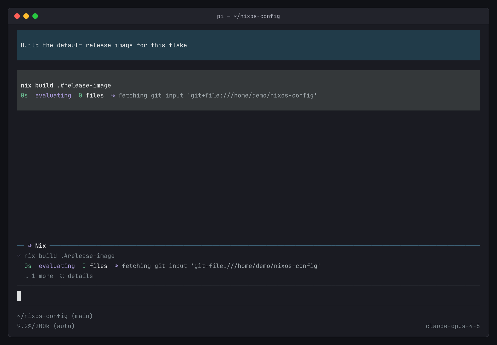
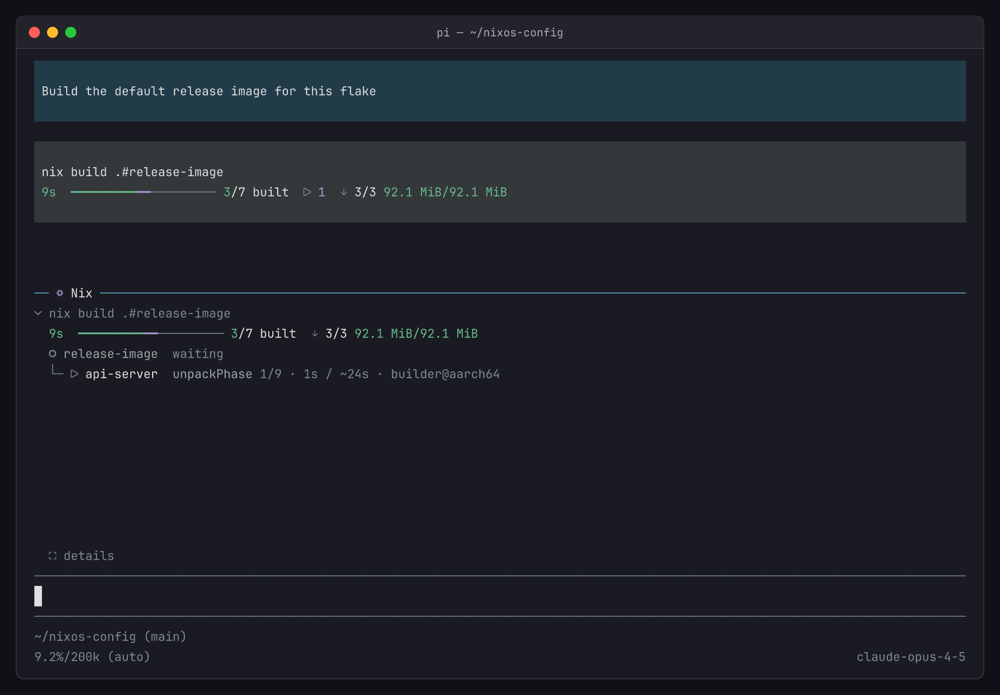
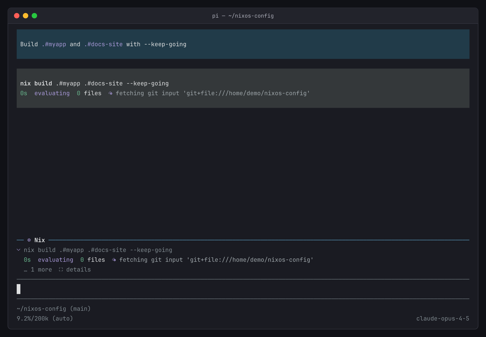

# pi-nix-build

[English](../../README.md) | 简体中文

面向 [pi](https://github.com/earendil-works/pi) 的 Nix 构建与求值扩展，提供实时进度展示、失败诊断与后台任务监控。

## 效果展示

### 实时进度组件

在编辑器上方实时展示求值进度、依赖树、stdenv 构建阶段、远程构建主机、耗时预估、传输进度，以及 `Ctrl+Shift+B` 折叠视图。



### 全屏详情视图（`Ctrl+Shift+M`）

左侧查看完整推导依赖树，右侧浏览对应构建日志，支持滚动暂停自动跟随（`↓ N newer lines`）与键盘/鼠标交互。



### 失败诊断与 Hash 不匹配

直接呈现失败推导、末尾日志、受阻下游（`⊘`）以及 Fixed-Output Hash 不匹配详情（`specified` 与 `got` 对比）。



## 功能特性

- **实时构建进度**：在编辑器上方展示求值进度、依赖树、构建阶段、远程构建主机及耗时预估。
- **全屏详情视图**：在构建过程中或结束后查看所有推导（derivation）及其日志。
- **Flake 与传统模式**：同时支持 `nix build`（Flake 目标）与 `nix-build`（文件、表达式及属性路径）。
- **Nix 求值**：`nix_eval` 通过 `nix eval` 或 `nix-instantiate --eval` 返回求值结果（默认 JSON），失败时返回带调用栈的报错，求值过程中获取源码或构建推导时显示实时进度。
- **失败诊断**：向 pi 返回失败推导、末尾日志、固定输出（fixed-output）哈希不匹配详情及完整日志路径。
- **后台构建与监听**：支持后台执行长耗时构建并按事件发送通知；若已加载 [`pi-processes`](https://github.com/aliou/pi-processes)，自动接入 `/ps`。
- **自动命令拦截**：拦截 Shell 与进程工具中的 `nix build` 和 `nix-build` 调用，转交 `nix_build` 执行。

## 环境要求

- [pi](https://github.com/earendil-works/pi)
- Node.js `>= 22.19.0`
- `PATH` 中可用的 `nix` / `nix-build` / `nix-instantiate`

## 安装

### 通过 pi 安装

```bash
# 从 npm 安装
pi install npm:pi-nix-build

# 或从 GitHub 安装
pi install git:github.com/Moraxyc/pi-nix-build

# 仅在当前会话加载（不写入配置）
pi -e npm:pi-nix-build
```

### 通过 Nix 构建

```bash
nix build github:Moraxyc/pi-nix-build
```

构建完成后，可通过 `pi -e ./result/lib/node_modules/pi-nix-build` 加载，或将该路径加入 pi 的 `packages` 配置。

### 从源码构建

```bash
npm ci
npm run build
pi install .
```

## 使用方式

安装完成后直接向 pi 下达构建或求值指令即可：

- “构建当前 flake 的默认包”
- “附加 `--keep-going` 构建 `.#checks.x86_64-linux.unit`”
- “从 `default.nix` 构建 `hello` 属性”
- “在后台运行此构建，若有推导失败则通知我”
- “nixpkgs 里的 `hello` 是什么版本？”
- “列出 `.#packages.x86_64-linux` 的属性名”

### 快捷键

| 快捷键         | 功能                                       |
| -------------- | ------------------------------------------ |
| `Ctrl+Shift+B` | 折叠或展开实时进度组件；多个构建时依次展开 |
| `Ctrl+Shift+M` | 打开当前展开或最近一次构建的全屏详情视图   |

## 文档导航

| 主题                   | English                                                  | 简体中文                                           |
| ---------------------- | -------------------------------------------------------- | -------------------------------------------------- |
| 工具、监听与拦截钩子   | [docs/en/tools.md](../en/tools.md)                       | [docs/zh/tools.md](tools.md)                       |
| 界面、快捷键与耗时历史 | [docs/en/ui-and-shortcuts.md](../en/ui-and-shortcuts.md) | [docs/zh/ui-and-shortcuts.md](ui-and-shortcuts.md) |
| 开发与架构说明         | [docs/en/development.md](../en/development.md)           | [docs/zh/development.md](development.md)           |

## 许可证

[MIT](../../LICENSE)
